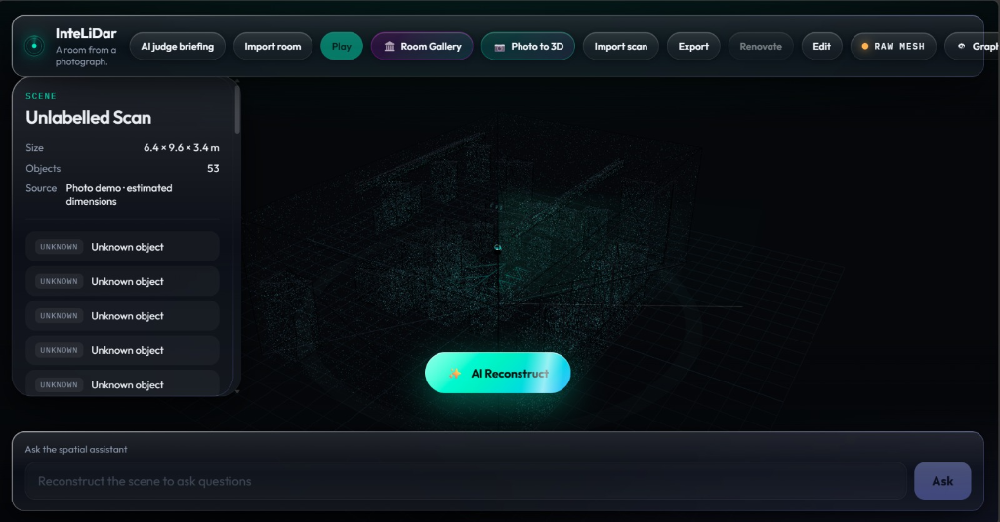
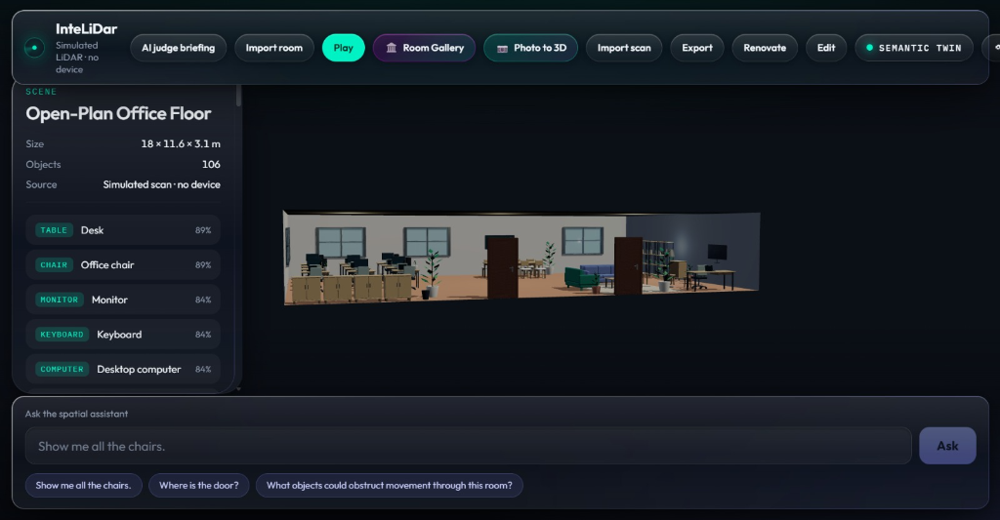
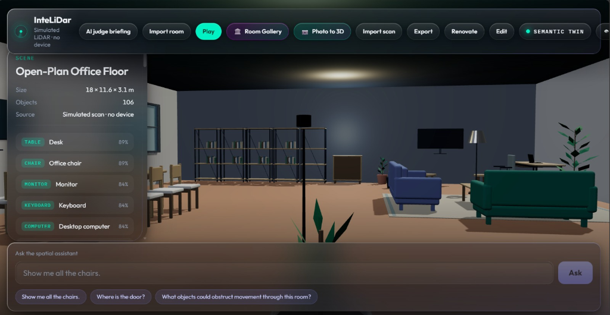

# GeoVision-AI

> **Scan reality. Let AI understand, reconstruct, and interact with it in 3D.**

GeoVision-AI transforms physical indoor spaces into interactive, **semantic digital twins**. By fusing measured LiDAR geometry with multimodal AI reasoning, GeoVision-AI classifies room objects, renders rich materials, answers natural language spatial queries, allows live layout renovation, and supports first-person physics walkthroughs.

---

## 📸 Screenshots & Visual Tour

### 1. Raw LiDAR Scan & AI Reconstruction
*The sensor beam sweeps the environment to gather measured bounds and unlabelled point-cloud volumes before real-time semantic synthesis.*



---

### 2. High-Precision Semantic Digital Twin
*Objects are classified into semantic categories (desks, ergonomic chairs, monitors, computers) with confidence scores, dimensions, and realistic PBR materials.*



---

### 3. Spatial AI Assistant & First-Person Exploration
*Ask spatial questions like "Show me all the chairs", "Where is the door?", or "What objects obstruct movement?" and see answers highlighted directly in 3D space.*



---

## ⚡ Quick Start

### Prerequisites
- **Node.js 20+**
- **Python 3.11+**

### 1. Installation

Clone the repository and install dependencies:

```bash
git clone https://github.com/Dhanushkumarsekar/GeoVision-AI.git
cd GeoVision-AI

# Install frontend dependencies
npm install

# Setup backend environment
cd backend
python -m venv .venv
# On Windows:
.venv\Scripts\pip install -e ".[dev]"
# On macOS/Linux:
.venv/bin/pip install -e ".[dev]"
cd ..
```

*(Optional)* Configure OpenAI credentials in `.env` for full LLM spatial reasoning (heuristic fallback is enabled by default if no key is provided):
```bash
cp .env.example .env
```

---

### 2. Running the Application

Open two terminal windows:

#### Terminal 1 — Backend API (FastAPI on Port 8000)
```bash
npm run backend
```

#### Terminal 2 — Frontend Dev Server (Vite on Port 5173)
```bash
npm run dev
```

Visit **[http://localhost:5173](http://localhost:5173)** in your browser.

---

### 3. Running Tests

```bash
# Run unit & component tests
npm run test:frontend

# Run launcher and script tests
npm run test:scripts

# Run complete test suite (scripts, frontend, backend, e2e)
npm test
```

---

## 🚀 Key Features

| Capability | Description | Status |
| --- | --- | --- |
| **Browser 3D Viewer** | Real-time Three.js / React Three Fiber viewer with glassmorphic HUD | ✅ Working |
| **Progressive Sensor Sweep** | Animated LiDAR beam and point cloud return accumulation | ✅ Working |
| **✨ AI Reconstruct** | Multi-step room classification, geometry fitting, and material assignment | ✅ Working |
| **Spatial AI Assistant** | Query room semantics (*"Show me all the chairs"*, *"Where is the door?"*) with 3D highlight feedback | ✅ Working |
| **Photo to 3D Conversion** | Convert 2D room photos into interactive 3D scene graphs | ✅ Working |
| **Preset 3D Room Gallery** | Switch between high-detail room environments (Offices, Cafés, Lounges) | ✅ Working |
| **Interactive Renovation** | Drag, reposition, rotate, and style furniture with appearance customizers | ✅ Working |
| **Desktop Play Mode** | Third-person avatar navigation with Rapier3D physics and seating interaction | ✅ Working |
| **Universal Export** | Export to `.geovision.json` scan file, CSV object schedule, SVG floor plan, or binary `.glb` model | ✅ Working |
| **Hardware & Simulated Ingest** | Native iOS RoomPlan LiDAR capture + built-in simulated office floor (18 × 11.6 m, 106 objects) | ✅ Working |

---

## 🛠️ Technology Stack

- **Frontend & Rendering:** Vite, React 19, Three.js, React Three Fiber (`@react-three/fiber`), Drei (`@react-three/drei`)
- **Physics Engine:** Rapier3D (`@dimforge/rapier3d-compat`, `@react-three/rapier`)
- **Backend API:** FastAPI, Uvicorn, Pydantic v2, Python 3.11+
- **Spatial Reasoning:** OpenAI GPT-4o / Heuristic spatial graph traversal
- **Capture:** Apple ARKit / RoomPlan iOS companion exporter
- **Testing:** Vitest, Playwright, Node Test Runner, Pytest

---

## 📐 Architecture & Data Flow

```text
┌─────────────────────────────────┐
│     Capture / Sensor Source     │
│  (iOS LiDAR / RoomPlan / Photo) │
└────────────────┬────────────────┘
                 │
                 ▼
┌─────────────────────────────────┐
│      Semantic Scene Graph       │  ◄── Normalized Source of Truth
└────────────────┬────────────────┘
                 │
        ┌────────┴────────┐
        ▼                 ▼
 ┌──────────────┐  ┌──────────────┐
 │ AI           │  │ Spatial      │
 │ Reconstruct  │  │ Assistant    │
 │ (Labels, PBR)│  │ (LLM + Graph)│
 └──────┬───────┘  └──────┬───────┘
        │                 │
        └────────┬────────┘
                 │
                 ▼
┌─────────────────────────────────┐
│       GeoVision-AI Viewer       │
│ Three.js · Liquid Glass HUD     │
│ Physics Avatar · Layout Editing │
└─────────────────────────────────┘
```

---

## 📂 Documentation

- [Getting Started Guide](docs/getting-started.md) — Detailed setup, environment variables, and troubleshooting
- [Architecture](docs/architecture.md) — Pipeline layers, coordinate systems, and data flow
- [Demo Presentation Script](docs/demo-script.md) — Step-by-step walkthrough for live presentations
- [Capture Guide](docs/capture.md) — iOS LiDAR RoomPlan ingest and simulated floor generation
- [Export Formats](docs/export.md) — Details on `.geovision.json`, CSV schedules, SVG blueprints, and GLB models
- [Playable Rooms](docs/playable-rooms.md) — First-person avatar navigation, controls, and GLB imports
- [HTTP API Reference](docs/api.md) — Endpoint specifications for scene ingest, reconstruction, and ask queries
- [Engineering Design](design.md) — Core system design and constraints
- [Product Brief](PRODUCT.md) — Product purpose, brand commitments, and platform scope

---

## 📄 License

MIT License. Built for real-time spatial intelligence and interactive digital twins.
